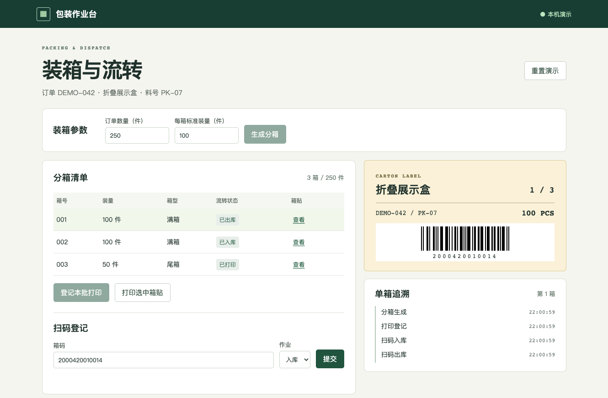
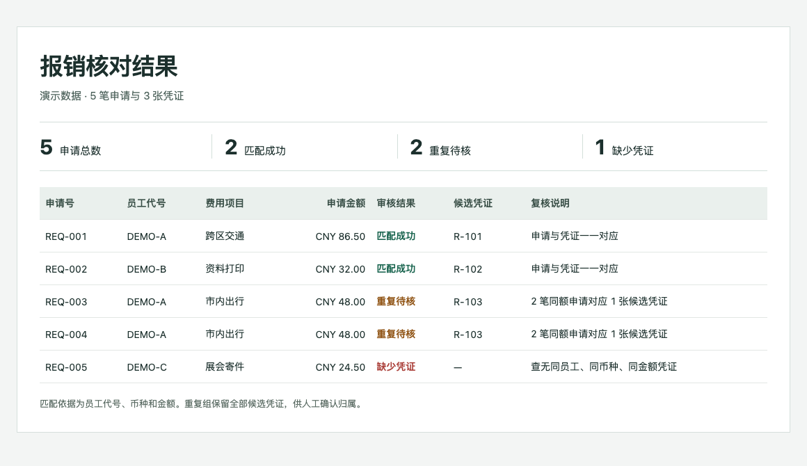
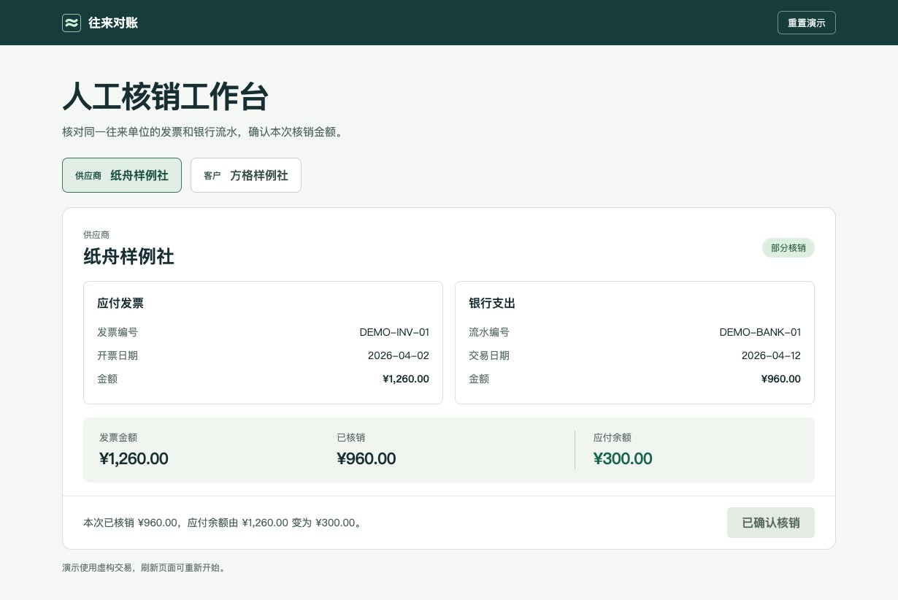

# 汪湛雨的项目作品集

我是税收学（国际税收方向）本科生。在财税和制造业实践中，我把经常需要人工核对的业务步骤整理成规则，再用小工具验证。这里选了三个可以动手试的例子，分别来自箱贴打印、报销审核和应收应付对账项目。公开示例均使用虚构数据。

## 箱贴打印与溯源

一批货有 250 件，每箱装 100 件。最后一箱只有 50 件，标签上该印多少？仓库再次扫到同一张箱贴，又该如何处理？

这个项目把每一箱的数量与箱码关联起来。可以从分箱结果选一箱，沿着打印登记、扫码入库和出库一路查看记录。这个例子的验收条件是各箱合计 250 件，重复扫描同一箱时只保留一条入库记录。

[查看演示代码与运行步骤](https://github.com/wangzhanyu405-pixel/wangzhanyu405-pixel/tree/main/projects/carton-label)

## 报销审核与凭证归档

两笔报销金额相同，应该把凭证归给哪一笔？报销工具先从系统截图和凭证中提取明细，再逐项比对，把有歧义的记录留给审核人。

公开示例从提取后的结构化明细开始。5 笔申请中有 2 笔唯一匹配，合计 118.50 元。另有两笔 48 元申请共用一张候选凭证，系统保留凭证号供复核。最后一笔因缺少凭证而单列。

[查看示例数据、审核代码与运行步骤](https://github.com/wangzhanyu405-pixel/wangzhanyu405-pixel/tree/main/projects/expense-review)

## 应收应付对账

银行流水里的一笔支出，究竟结清了供应商的哪张发票？这个例子从往来单位入手，把流水与未结发票放在一起，展示匹配依据，并保留人工确认环节。

示例中，一张 1,260 元的应付发票对应一笔 960 元的付款。确认后未结余额为 300 元，重复确认会被拦截。切换到客户，还可以看到等额收款结清应收的情况。完整平台还包括银行流水、发票台账和应收、应付工作台。这里单独展示核对一笔款项的过程。

[查看对账示例与运行步骤](https://github.com/wangzhanyu405-pixel/wangzhanyu405-pixel/tree/main/projects/reconciliation)

