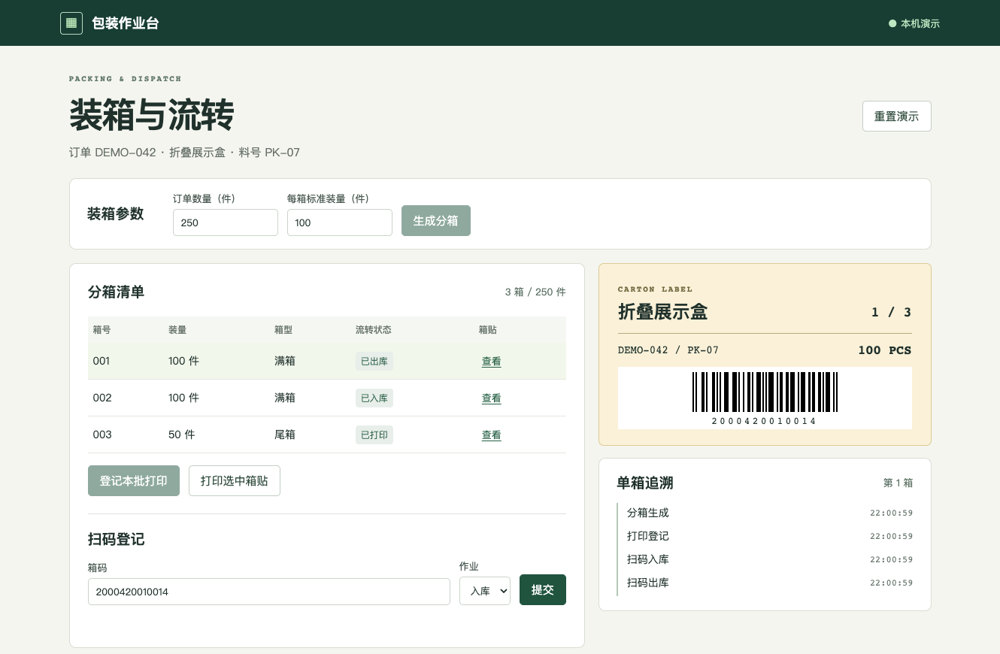

# 装箱与流转工作台

[箱贴打印与溯源完整源码](https://github.com/wangzhanyu405-pixel/wangzhanyu405-pixel/tree/main/source/carton-label-platform)

用一张虚构订单演示包装现场的单箱流转。输入 250 件、每箱标准装量 100 件，系统拆成两个 100 件满箱和一个 50 件尾箱。每箱有独立条码，可以依次登记打印、入库、出库并查看时间记录。



## 运行

直接用现代浏览器打开同目录的 `index.html`。也可以在此目录启动本地静态服务，便于浏览器持久保存记录。

```sh
python3 -m http.server 8080 --bind 127.0.0.1
```

打开 [本地工作台](http://127.0.0.1:8080/)。页面由原生 HTML、CSS 和 JavaScript 实现，全部资源位于本目录，可离线运行。

## 试用顺序

1. 核对订单数量和每箱装量，点击「生成分箱」。
2. 点击「登记本批打印」，用「查看」选择任意一箱。右侧显示该箱的标签，扫码输入框会自动填入箱码。「打印选中箱贴」会打开浏览器打印对话框，可选择存为 PDF。
3. 扫码作业选择「入库」后提交，再选择「出库」并提交。也可用模拟键盘输入的扫码枪读取 EAN-13 条码。出库前必须已入库，重复扫描会提示。
4. 扫码作业选择「追溯」，输入箱码后提交，即可查看该箱各环节的登记时间。刷新后可继续操作，「重置演示」会清除当前浏览器中的数据。

## 展示边界

这是重新编写的公开演示，采用一张虚构订单、虚构料号和内部演示条码。打印登记由操作者手动确认，物理打印结果由浏览器和驱动处理。所有记录保存在当前浏览器的本地存储中，无账号、服务器数据库或跨设备同步，未接入生产 ERP、仓库或打印设备。
