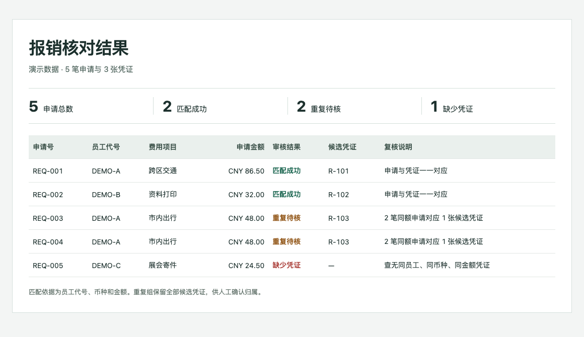

# 报销申请与凭证核对

[报销审核与归档完整源码](https://github.com/wangzhanyu405-pixel/wangzhanyu405-pixel/tree/main/source/expense-review-archive)

同一员工有两笔 48 元的报销申请，系统只有一张 48 元凭证。直接按金额关联会让两笔都显得有据可查。这个示例检查同组申请与凭证的数量，将冲突的两笔都交给审核人，并保留对应的凭证号。



## 运行示例

需要 Python 3.8 或更高版本，仅使用标准库。在本目录运行：

```sh
python3 review.py
```

浏览器打开 `output/review.html` 查看结果，用 Excel 打开 `output/review.csv` 可筛选待核项目。内置样例的两笔唯一匹配金额合计 **118.50 元**。两笔 48 元申请共用一个候选凭证号，另一笔 24.50 元申请缺少凭证。

## 输入与核对规则

- [申请表](claims.csv) 包含申请号、员工代号、费用项目、币种和金额。[凭证表](receipts.csv) 包含凭证号、员工代号、币种和金额。两份数据均为虚构。
- 用员工代号、币种和金额分组，以十进制金额精确核对。组内一笔申请对应一张凭证时标为匹配成功；存在多个候选或多笔同额申请时标记重复待核；没有候选时标记缺少凭证。
- 完整报销流程从 Word 截图识别费用明细，再解析 PDF、核对抬头并归档票据。此公开示例从两张已结构化的 CSV 开始，展示其中的匹配和人工复核环节，可离线运行。
