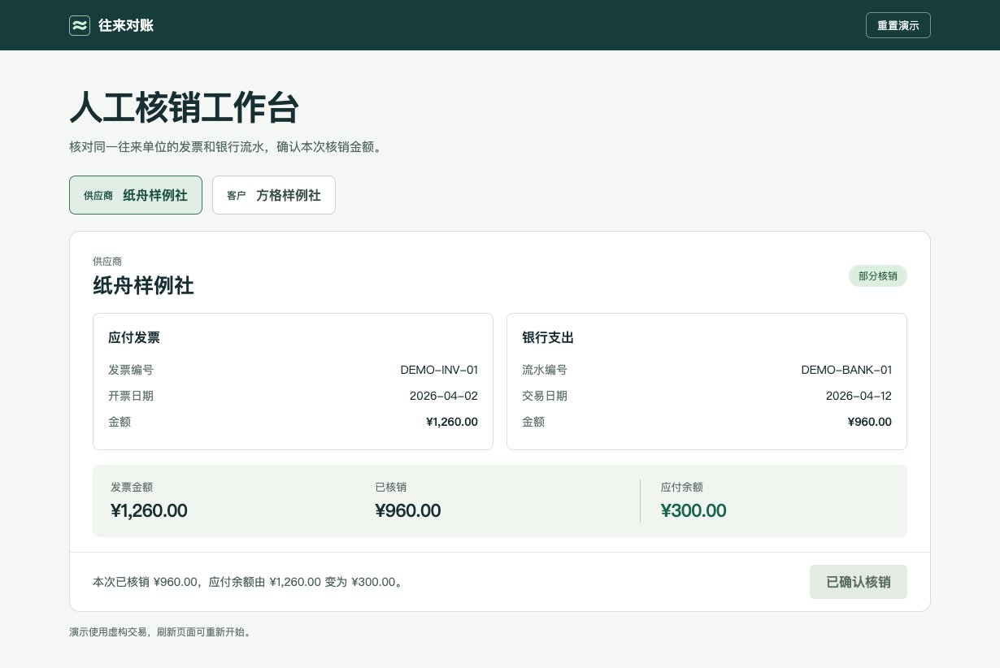

# 人工核销工作台

一个可直接点击的财务对账样例。每个往来单位有一张发票和一笔同方向的银行流水。切换单位可以查看单据，确认核销后，发票未结余额随之更新。



## 运行

直接用浏览器打开 [index.html](index.html)。也可以在本目录运行以下命令，然后访问 [本机演示](http://127.0.0.1:8080)。

```sh
python3 -m http.server 8080 --bind 127.0.0.1
```

## 验证

1. 默认选中供应商「纸舟样例社」。核对 1,260 元应付发票和 960 元银行支出。点击「确认核销」，已核销金额变为 960 元，应付余额降至 300 元，状态变为「部分核销」。
2. 切换客户「方格样例社」。其应收余额仍为 1,880 元。核对同额银行收入并确认，应收余额降至 0 元，状态变为「已结清」。
3. 切回供应商，余额仍为 300 元，确认按钮已禁用。点击「重置演示」或刷新页面可恢复初始数据。

所有交易均为虚构。金额按整数分计算，状态仅保存在当前页面内存。此样例只演示一张发票和一笔流水之间的人工核销，不连接银行、数据库或外部服务。
